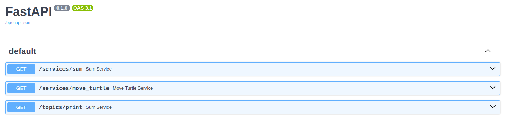
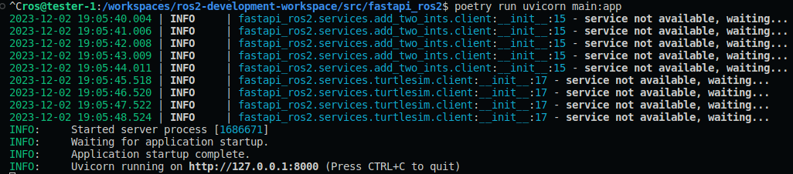
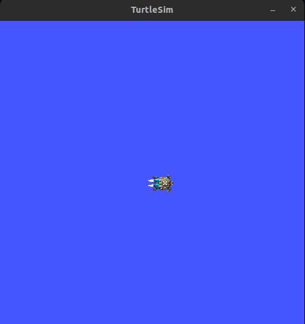
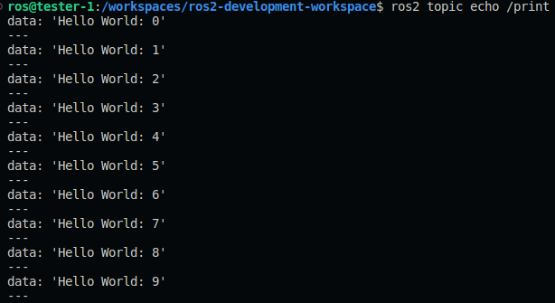

# A FastAPI-based API for ROS2 applications
A FastAPI app that talks to [ROS 2 Lyrical](https://docs.ros.org/en/lyrical/index.html) through rclpy.
It is a plain Python app, run from source and managed with [uv](https://docs.astral.sh/uv/), not a colcon-built ROS package.
rclpy and the ROS message packages it uses come from the ROS installation, which the app's venv sees through `--system-site-packages`.

## Quick start with Docker

Run the API, turtlesim, and the `add_two_ints` service on ROS 2 Lyrical with one command:

```
docker compose up --build
```

Then go to **http://127.0.0.1:8000/docs**.
If port 8000 is taken, pick another host port with `API_PORT=8001 docker compose up --build`.
Turtlesim runs headless in the container, so check the turtle's position with:

```
docker compose exec turtlesim bash -c 'source /opt/ros/lyrical/setup.bash && ros2 topic echo --once /turtle1/pose'
```

## Development

There are two Docker-based workflows, both on the same image as the quick start.

**Any editor, with `docker compose watch`.**
Run `docker compose watch` and edit on the host.
Saving a file under `fastapi_ros2/` or `main.py` syncs it into the containers and restarts the `api` and `add_two_ints` services.
Changing `pyproject.toml` or `uv.lock` rebuilds the image.

**Dev container.**
Open the repo in VS Code (or another client that supports dev containers) and reopen it in the container.
This starts turtlesim and `add_two_ints` next to a `dev` container with the repo mounted at `/app`, ROS sourced, and the dev tools (ruff, basedpyright, pytest) installed.
Start the API yourself from a terminal in the container, so you can use reload and the debugger:

```
uvicorn main:app --host 0.0.0.0 --port 8000 --reload
```

If the API stops itself because a ROS callback failed (see [Health](#health)), the reloader keeps running without a server until the next file change, so save a file or restart uvicorn.

The dev container is a separate compose project, so it can run alongside `docker compose up`, as long as they use different `API_PORT` values.

**Lint and tests.**
The [`justfile`](justfile) has the recipes, and `just check` runs ruff, basedpyright, and pytest without changing any file, as CI does on every push.
`just lint` and `just format` fix and format in place.
basedpyright runs in its `recommended` mode, so warnings fail the check too.
The tests run the API with its real ROS node and serve the ROS services from the test process, on a ROS domain of their own, so they need ROS installed but no running services.
Run it in the dev container, or from a host with [just](https://just.systems) installed:

```
just check-in-docker
```

**Without Docker.**
With ROS 2 Lyrical installed and sourced, create a venv on the system Python that sees the ROS packages, then install the dependencies:

```
uv venv --system-site-packages --python /usr/bin/python3
uv sync --locked
```

Then run any of the nodes as a module, for example the publisher example:

```
uv run python -m fastapi_ros2.examples.print_publisher
```

## Starting the API with `topics` and `services` routes
The current version of the API has the following endpoints available:



These allow:
- publishing to a topic `/print` a message of type `string`, using the `topics` route.
- place a request to the service `example_interfaces.srv.AddTwoInts` to sum up two integers and get the result back.
- place a request to the service `turtlesim_msgs.srv.TeleportAbsolute` to perform an absolute movement (position in cartesian x,y coordinates and angle in radians).

To start the app, run the following command from the package root directory:

```
uv run uvicorn main:app
```



Then go to **http://127.0.0.1:8000/docs**

### Services

This version of the app includes two services endpoints: `POST /services/sum` and `POST /services/move_turtle`.
They take JSON bodies, for example:

```
curl -X POST localhost:8000/services/sum -H 'Content-Type: application/json' -d '{"a": 2, "b": 3}'
curl -X POST localhost:8000/services/move_turtle -H 'Content-Type: application/json' -d '{"x": 3, "y": 4, "theta": 1.5}'
```

Inputs are validated against the ROS message field types before they reach ROS: integers must fit in 64 bits (and so must their sum), and floats must be finite and fit in 32 bits.
Invalid input returns `422`.
Request and response bodies mirror the ROS service's request and response fields, so `/services/sum` returns `{"sum": 5}` and `/services/move_turtle` returns `{}`, since `TeleportAbsolute` responds with no fields.
Their Pydantic models declare the ROS types' fields, and `@mirrors` in `fastapi_ros2/api/v1/models.py` checks at import that they match the ROS messages' names, order, and types.
The endpoints await asynchronous clients for each of the ROS2 services, so a slow service does not block the rest of the API.
The API starts whether or not the services are running.
A call returns `503` if its service is not available and `504` if it does not respond within 5 seconds.

The services live in the `services` module of the package, where any new service must be placed. When creating a new service, including both the `server` and `client` modules is recommended.

From the package location, start the `add_two_ints` service:
```
uv run python -m fastapi_ros2.services.add_two_ints.server
```

Start the `turtlesim` service:

```
ros2 run turtlesim turtlesim_node
```

This will spawn a new **turtlesim** window that is tied to the server that will receive the movement requests:



This window will show the movements of the turtle when the `POST /services/move_turtle` endpoint is used.

### Topics

When using the endpoint `POST /topics/print`, from a different terminal, sniff the `/print` topic with:

```
ros2 topic echo /print
```

The terminal should show the messages published to the topic:



The same will apply for any topic added to the API through the `topics` route.

### Health

`GET /health` reports whether the API can talk to ROS:

```
curl localhost:8000/health
```

```json
{"status": "ok", "node": {"name": "/fastapi_ros2", "spinning": true}, "services": {"/add_two_ints": true, "/turtle1/teleport_absolute": true}}
```

- `node.spinning`: the API's ROS node is processing callbacks; without it no service response or topic message arrives.
- `services`: every service the API calls, and whether it is currently available.

It returns `200` when everything is ready and `503` otherwise, with the same body.

If a ROS callback in the API raises, its node stops spinning for good, so the API logs the error and shuts itself down.
Docker Compose restarts it (`restart: unless-stopped`), so it recovers in about a second; a manual `docker compose stop` or `down` does not trigger a restart.
Compose also runs `/health` as the `api` service's healthcheck, so `docker compose ps` shows whether the API is ready, and `docker compose up -d --wait` returns once it is.
Run outside Docker, the process just exits.
