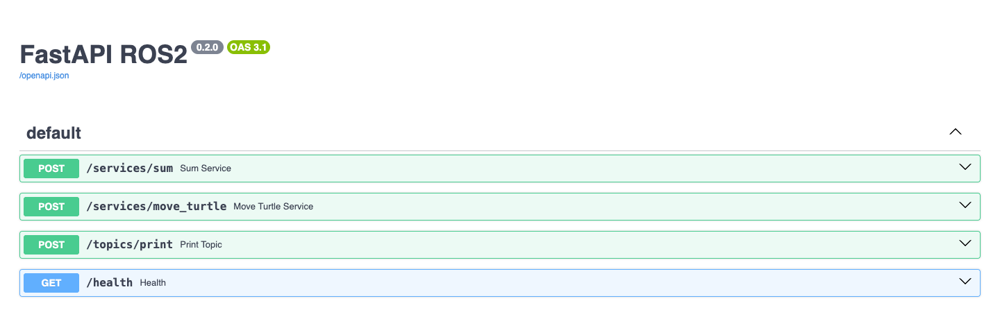

# A FastAPI-based API for ROS2 applications
A FastAPI app that talks to [ROS 2 Lyrical](https://docs.ros.org/en/lyrical/index.html) through rclpy.
It is a plain Python app, run from source and managed with [uv](https://docs.astral.sh/uv/), not a colcon-built ROS package.
rclpy and the ROS message packages it uses come from the ROS installation, which the app's venv sees through `--system-site-packages`.

## Quick start with Docker

Run the API, turtlesim, and the `add_two_ints` service on ROS 2 Lyrical with one command:

```
docker compose up --build
```

Then go to **http://127.0.0.1:8000/docs**.
If port 8000 is taken, pick another host port with `API_PORT=8001 docker compose up --build`.
Turtlesim runs headless in the container, so check the turtle's position with:

```
docker compose exec turtlesim bash -c 'source /opt/ros/lyrical/setup.bash && ros2 topic echo --once /turtle1/pose'
```

## Endpoints



- `POST /services/sum` calls the `example_interfaces/srv/AddTwoInts` service to add two integers.
- `POST /services/move_turtle` calls the `turtlesim_msgs/srv/TeleportAbsolute` service to move the turtle to a position (x, y) and an angle in radians.
- `POST /topics/print` publishes a `std_msgs/msg/String` message to the `/print` topic.
- `GET` and `PUT /nodes/{node}/parameters/{name}` read and set a parameter of any node.
- `GET /graph` lists the nodes, topics, services, and actions in the ROS graph.
- `GET /health` reports whether the API can talk to ROS.

### Services

The service endpoints take JSON bodies:

```
curl -X POST localhost:8000/services/sum -H 'Content-Type: application/json' -d '{"a": 2, "b": 3}'
curl -X POST localhost:8000/services/move_turtle -H 'Content-Type: application/json' -d '{"x": 3, "y": 4, "theta": 1.5}'
```

Inputs are validated against the ROS message field types before they reach ROS: integers must fit in 64 bits (and so must their sum), and floats must be finite and fit in 32 bits.
Invalid input returns `422`.
Request and response bodies mirror the ROS service's request and response fields, so `/services/sum` returns `{"sum": 5}` and `/services/move_turtle` returns `{}`, since `TeleportAbsolute` responds with no fields.
Their Pydantic models declare the ROS types' fields, and `@mirrors` in `fastapi_ros2/api/v1/models.py` checks at import that they match the ROS messages' names, order, and types.
The endpoints await asynchronous clients for each of the ROS2 services, so a slow service does not block the rest of the API.
The API starts whether or not the services are running.
A call returns `503` if its service is not available and `504` if it does not respond within 5 seconds.

The services live in the `services` module of the package, where any new service must be placed.
When creating a new service, including both the `server` and `client` modules is recommended.

### Topics

Listen on the `/print` topic:

```
docker compose exec turtlesim bash -c 'source /opt/ros/lyrical/setup.bash && ros2 topic echo /print'
```

Each `POST /topics/print` returns the number of messages published so far, for example `{"count": 1}`, and the listener prints the message:

```
data: 'Hello World: 0'
---
data: 'Hello World: 1'
---
```

### Parameters

`GET /nodes/{node}/parameters/{name}` reads a parameter of any node in the graph, and `PUT` sets it, as `ros2 param get` and `ros2 param set` do.
For example, set the red channel of turtlesim's background:

```
curl localhost:8000/nodes/turtlesim/parameters/background_r
curl -X PUT localhost:8000/nodes/turtlesim/parameters/background_r -H 'Content-Type: application/json' -d '{"value": 255}'
```

Both return the parameter, here `{"name": "background_r", "value": 255}`.
`{node}` is the node's fully qualified name without the leading slash, for example `my_namespace/my_node`.
The value can be a boolean, integer, float, string, or a list of one of those, and the node checks it: turtlesim refuses `300` (out of its 0 to 255 range) or `"red"` (not an integer) with `422` and the node's reason.
A whole number for a float parameter is taken as a float, since JSON clients often send `1.0` as `1`.
An unknown node or parameter returns `404`, and a node that does not answer returns `503` or `504`, as the service endpoints do.

### Graph

`GET /graph` shows what the API's node sees of the ROS graph, as `ros2 node list` and `ros2 <topic|service|action> list -t` do:

```
curl localhost:8000/graph
```

```json
{"nodes": ["/add_two_ints_service", "/fastapi_ros2", "/turtlesim"], "topics": {"/turtle1/pose": ["turtlesim_msgs/msg/Pose"], ...}, "services": {"/add_two_ints": ["example_interfaces/srv/AddTwoInts"], ...}, "actions": {"/turtle1/rotate_absolute": ["turtlesim_msgs/action/RotateAbsolute"]}}
```

Names are fully qualified and map to their types.
Like ros2cli, it leaves out hidden names, such as the topics and services each action is built on.
Discovery is asynchronous, so a node that just started or stopped may take a moment to show or disappear.

### Health

`GET /health` reports whether the API can talk to ROS:

```
curl localhost:8000/health
```

```json
{"status": "ok", "node": {"name": "/fastapi_ros2", "spinning": true}, "services": {"/add_two_ints": true, "/turtle1/teleport_absolute": true}}
```

- `node.spinning`: the API's ROS node is processing callbacks; without it no service response or topic message arrives.
- `services`: every service the API calls, and whether it is currently available.

It returns `200` when everything is ready and `503` otherwise, with the same body.

If a ROS callback in the API raises, its node stops spinning for good, so the API logs the error and shuts itself down.
Docker Compose restarts it (`restart: unless-stopped`), so it recovers in about a second; a manual `docker compose stop` or `down` does not trigger a restart.
Compose also runs `/health` as the `api` service's healthcheck, so `docker compose ps` shows whether the API is ready, and `docker compose up -d --wait` returns once it is.
Run outside Docker, the process just exits.

## Development

There are two Docker-based workflows, both on the same image as the quick start.

**Any editor, with `docker compose watch`.**
Run `docker compose watch` and edit on the host.
Saving a file under `fastapi_ros2/` or `main.py` syncs it into the containers and restarts the `api` and `add_two_ints` services.
Changing `pyproject.toml` or `uv.lock` rebuilds the image.

**Dev container.**
Open the repo in VS Code (or another client that supports dev containers) and reopen it in the container.
This starts turtlesim and `add_two_ints` next to a `dev` container with the repo mounted at `/app`, ROS sourced, and the dev tools (ruff, basedpyright, pytest) installed.
Start the API yourself from a terminal in the container, so you can use reload and the debugger:

```
uvicorn main:app --host 0.0.0.0 --port 8000 --reload
```

If the API stops itself because a ROS callback failed (see [Health](#health)), the reloader keeps running without a server until the next file change, so save a file or restart uvicorn.

The dev container is a separate compose project, so it can run alongside `docker compose up`, as long as they use different `API_PORT` values.

**Lint and tests.**
The [`justfile`](justfile) has the recipes, and `just check` runs ruff, basedpyright, and pytest without changing any file, as CI does on every push.
`just lint` and `just format` fix and format in place.
basedpyright runs in its `recommended` mode, so warnings fail the check too.
The tests run the API with its real ROS node and serve the ROS services from the test process, on a ROS domain of their own, so they need ROS installed but no running services.
Run it in the dev container, or from a host with [just](https://just.systems) installed:

```
just check-in-docker
```

**Without Docker.**
With ROS 2 Lyrical installed and sourced, create a venv on the system Python that sees the ROS packages, then install the dependencies:

```
uv venv --system-site-packages --python /usr/bin/python3
uv sync --locked
```

Start the services, each in its own terminal, then the API:

```
uv run python -m fastapi_ros2.services.add_two_ints.server
ros2 run turtlesim turtlesim_node
uv run uvicorn main:app
```

Then go to **http://127.0.0.1:8000/docs**.
Turtlesim opens a window that shows the turtle move on each `POST /services/move_turtle`.

The `examples` module has standalone nodes to run the same way, for example the publisher:

```
uv run python -m fastapi_ros2.examples.print_publisher
```
